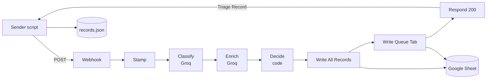

# Architecture write-up

## System design

A Request is a JSON body posted to an n8n webhook. Nothing else triggers the workflow. After that it runs in one pass.

`Stamp Request` gives the Request an id and the time received, and checks the Source and message. A bad Request gets a 400 reply and no Triage Record. `Classify` and `Enrich` are Code nodes that call Groq. `Decide` is plain code with no AI. The record is written to the `All Records` tab and to the tab of its final Queue, and the webhook returns the full Triage Record. A failed Sheet write does not lose the Request.

The workflow holds no state between Requests. State lives in n8n's Docker volume (the workflow and the Google credential), the Google Sheet (the Triage Records), and the output files (`output/records.json`, `output/eval/`). The Groq key comes from `.env`. Prompts and decision code are files in the repo; `npm run sync` copies them into the workflow JSON, so the tested code is the code that runs.

## Routing logic

The AI chooses text (Category, Priority, Confidence). Code applies the rules, so routing is testable without the AI. `src/decision.js` has unit tests for every mapping and boundary.

| Category | Standard Queue |
|---|---|
| Bug Report | Engineering |
| Incident/Outage | Engineering (on-call) |
| Feature Request | Product |
| Billing Issue | Billing |
| Technical Question | Customer Success |

Each Category maps to one team, so a Queue can be audited from the Category alone. With the Escalation Queue there are six. An escalated record still shows its Standard Queue, so a reviewer knows where to send it afterwards.

## Escalation logic

A record goes to the Escalation Queue if any reason applies. All reasons that apply are recorded, in this order:

1. `low_confidence`: Confidence below 0.70 (0.70 itself does not escalate).
2. `incident`: the Category is Incident/Outage.
3. `outage_signal`: the enrichment call judged that the Request describes a live outage affecting many users, whatever the Category.
4. `overcharge_over_500`: Overcharge above $500 ($500 itself does not escalate).
5. `ai_failure`: an AI step failed after 3 tries.

- 0.70 and the outage and money triggers come from the brief.
- The money rule uses the Overcharge (charged minus expected), not the invoice total. A large invoice that is $50 too high is a small dispute. Code computes it; the AI never does the arithmetic. Sample #3 is charged $1,240 against $980 expected, so its Overcharge is $260 and it is not escalated.
- I first built the brief's outage keyword rule as a backup, then removed it. Keywords miss "nobody on our team can get in" and flag "we had an outage last year, all fine now". The Outage Signal replaces it: a second, independent AI judgement from the text. Some false Escalations are accepted to avoid a missed outage, and false-alarm samples measure them.
- Every Incident/Outage escalates, which is why there is no on-call Sheet tab: those records land in `Escalation`.
- The rules fail closed. A missing or out-of-range Confidence, a non-boolean Outage Signal, a null response or an unknown Category escalates with `ai_failure`.

## Model choice

`openai/gpt-oss-120b` on Groq's free tier, temperature 0, JSON mode. Classification accuracy mattered more to me than running offline, so I chose a hosted, much larger model over a local one (Claude first suggested Ollama with `qwen2.5`). Llama 3.3 70B was my next choice, but Groq no longer offers it. Of the two remaining general-purpose models, both returned valid JSON on sample #5, and I picked the larger. Every Triage Record names its model. See `AI_USAGE.md`.

## Results

The five required samples land where the spec expects (`output/records.json`):

| # | Category | Priority | Confidence | Final Queue | Escalation Reasons |
|---|---|---|---|---|---|
| 1 | Bug Report | Medium | 0.96 | Engineering | none |
| 2 | Feature Request | Low | 0.96 | Product | none |
| 3 | Billing Issue | Medium | 0.96 | Billing | none |
| 4 | Technical Question | Low | 0.80 | Customer Success | none |
| 5 | Incident/Outage | High | 0.97 | Escalation | incident, outage_signal |

`npm run eval` sent 11 samples (5 required, 6 edge cases) three times each, 33 Requests, and compared each Triage Record with `samples/expectations.json` (results in `output/eval/`). All 15 required runs and all 18 edge-case runs pass, with no AI errors and no false Escalations. The over-$500 Overcharge escalated, both false alarms stayed unescalated in every run, the French outage escalated, and the vague one-liner got Confidence 0.60 and escalated.

Two findings. Sample #4 was more confident than the spec expected: Technical Question at 0.75 to 0.80 in every run, so it goes to Customer Success. I changed the expectation instead of tuning the prompt for one sample. And the mixed bug-and-billing message was a Bug Report twice and a Billing Issue once at temperature 0, so the model is not deterministic on borderline Requests.

Limits: three runs per sample is few, and the labels and prompts were written by the same person.

## Production scale

**Reliability.** The webhook replies only after both AI calls and both Sheet writes. In production I would queue Requests, process them with workers, and make writes idempotent on the Request id (duplicate ids are not detected today). Requests that still fail would go to a dead-letter queue as well as the Escalation Queue. I would monitor error rate, 429 rate, Escalation rate and Confidence drift. The Google sign-in expires after 7 days in Testing mode, so production needs a service account or a Workspace app.

**Cost.** I did not measure tokens per Request. The free tier limit of 8,000 tokens per minute forced me to space Requests 20 seconds apart. Options: a smaller model for easy cases, with the large one only on low Confidence; prompt caching for the fixed prompt text; batching.

**Latency.** The two calls run in sequence, and retries pause 10 s and 20 s. The enrichment call uses the Category only as context, so the calls could run in parallel or merge into one. Rate limits set the worst case.

**Not built.** Webhook authentication, removal of personal data before text goes to a third-party model, rate limiting, and cost controls.

## Phase 2

- Confidence from self-consistency or log probabilities, in place of one self-reported number.
- A feedback loop: human corrections in the Escalation Queue feed the prompts and the evaluation set.
- Real integrations in place of Sheet tabs: Jira, Slack, PagerDuty.
- A larger labelled evaluation set from real Requests.
- A dashboard for volume, Escalation rate and Confidence over time.
